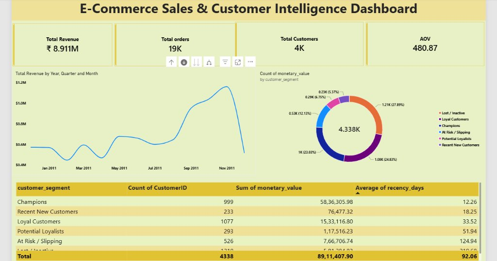
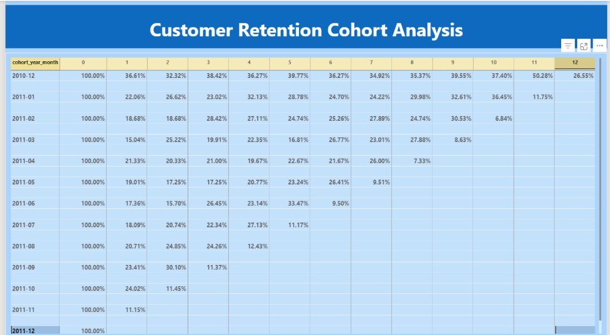

# 🛒 End-to-End E-Commerce Customer Retention & Sales Intelligence Pipeline

> An end-to-end data analytics pipeline using **Python (ETL)**, **MySQL (Cohort & RFM Modeling)**, and **Power BI (DAX & Executive Dashboarding)** to analyze customer retention and revenue concentration across 390,000+ transactions.

---

## 📌 Business Overview
In retail and e-commerce, customer acquisition cost (CAC) continues to rise. For sustained profitability, understanding **Customer Retention** and identifying **High-Value Customer Segments (RFM)** is essential.

This project addresses three core executive questions:
1. **Customer Retention:** Exactly when do customers drop off after their initial purchase? (12-Month Cohort Analysis)
2. **Value Concentration (RFM):** What percentage of customers generate the bulk of company revenue?
3. **Executive Visibility:** How can decision-makers monitor sales momentum, AOV, and customer churn dynamically?

---

## 🛠️ Architecture & Pipeline

```
[Raw E-Commerce CSV (540K+ rows)]
              │
              ▼
 1. Python (Pandas, SQLAlchemy, Jupyter)
    • Data cleaning: Removed null CustomerIDs and canceled transactions
    • Feature engineering: TotalAmount, InvoiceMonth
    • Automated ingestion into MySQL
              │
              ▼
 2. MySQL 8.0 Data Warehouse
    • Stored 390,000+ clean transaction records
    • View 1: 12-Month Cohort Retention Matrix (TIMESTAMPDIFF, CTEs)
    • View 2: RFM Customer Segmentation (NTILE(5), Window Functions)
              │
              ▼
 3. Power BI & DAX Reporting
    • Direct database connection
    • Custom DAX measures: Retention Rate %, AOV, Total Revenue
    • 2-Page Executive Dashboard with Cohort Heatmap
```

---

## 📊 Key Business Insights

* 🏆 **The 80/20 Rule Confirmed:** The **"Champions"** segment accounts for **23% of total customers** (999 users) but generates **65.5% of total company revenue (₹58.36L / ₹89.11L)** with an average recency of only 12.2 days.
* 📉 **Month 1 Drop-off:** The cohort retention matrix revealed customer retention drops to **22%–36% by Month 1**, indicating that targeted onboarding incentives within the first 30 days are critical.
* ⚠️ **At-Risk Revenue:** 526 previously loyal customers have not placed an order in over **124 days**, representing ₹7.66L in slipping revenue that marketing can re-engage.

---

## 📸 Dashboard Screenshots

### Page 1: Executive Sales & Customer Intelligence


### Page 2: Customer Retention Cohort Analysis (Heatmap)


---

## 📂 Repository Structure
```
├── 01_ecommerce_etl_pipeline.ipynb      # Python data cleaning & automated database loading
├── 02_cohort_and_rfm_queries.sql        # Advanced SQL CTEs, Window Functions, and Views
├── etl_pipeline.py                      # Standalone Python ETL script
├── assets/                              # Dashboard screenshots
│   ├── page1_executive_dashboard.jpg
│   └── page2_cohort_retention_heatmap.jpg
├── .gitignore
└── README.md
```

---

## 🚀 How to Run Locally
1. Clone this repository:
   ```bash
   git clone https://github.com/dinnu03062005/e-commerce-retention-analytics-pipeline.git
   ```
2. Download the dataset and place it in the project root as `data.csv`.
3. Open Jupyter Notebook and execute `01_ecommerce_etl_pipeline.ipynb` to clean data and populate MySQL.
4. Run `02_cohort_and_rfm_queries.sql` in MySQL Workbench to generate the analytical views.
5. Connect Power BI Desktop to `ecommerce_db` and open your report!
